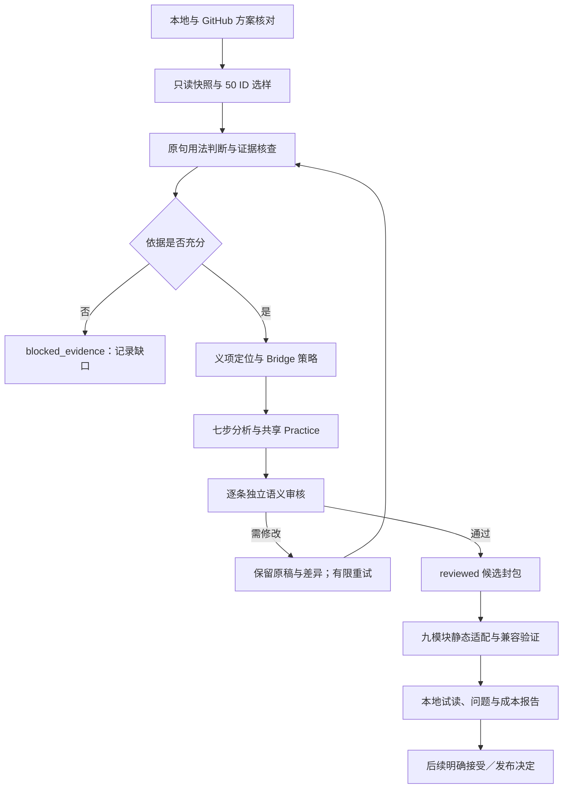

# V10 试生产流程与数据合同 r1

日期：2026-11-16。配套 [实施单](PILOT50_EXECUTION_PLAN_20261116.md)。状态为待实现合同；具体完成项看运行报告。

## 流程及闸门

## 数据实体

| 实体 | 必填信息 | 约束 |
| --- | --- | --- |
| EntrySnapshot | 原 ID、term、原句、日期、文件 SHA | 不回写原库；全短语保留 |
| SourceEvidence | sourceId、URL／文件、访问日期、版本、支持主张、许可／引用方式、限制 | 只能支持实际核查内容；缺少来源不称 verified |
| SenseInventory | inventoryId、版本、senseId、词性、释义、sourceRefs、coverage | 仅所采用资料范围，不称客观穷尽 |
| LearningSelection | inventoryRef、selectedSenseIds、选取理由 | 无真实频率数据不标频率排名 |
| ContextUse | contextId、entryId、原句、译文、targetSpan、当前义、限定条件、provenance | exact span 或显式解释词形／上下文映射；不改原句 |
| Bridge | location、strategy、senseRefs、解释、限制、optionalHistory | 定位和联系分别编码；历史必须另有证据 |
| Practice | practiceId、version、活动目标、角色、证据、回应、边界 | 单独版本管理，多对多引用；不强挂无关实践 |
| Analysis | depth、七维覆盖、连续正文、localPractice、typedEdges、workplaceUse | 每个关系说明原因；2–5 原创短句附中文与适用条件 |
| Review | reviewer、inputFingerprint、artifactHash、contentRevision、逐项判定、问题、时间、结论 | 绑定具体稿件；逐条且独立；schema 通过不等于语义通过 |
| ReleaseManifest | runId、输入与 Prompt SHA、依赖版本、各条状态、模块版本、产物 SHA、指标 | accepted 与 published 分离；不能把半文件当完成 |

定位枚举：`selected / inventory_not_selected / new_source_sense / context_specific / whole_expression / unresolved`。

联系枚举：`direct / contextualization / evidenced_modern_link / memory_analogy / needs_specialist_concept / no_derivation`。

unresolved 必须停止肯定性解释；whole_expression 不表示可以省去来源；memory_analogy 仅作记忆提示，不作词源或义项证据。Bridge 中补充历史与传统历史模块分别保存与渲染。

## 状态、版本与恢复

主链 `queued → evidence_ready → drafted → reviewed → accepted`；异常 `needs_revision / blocked_evidence / rejected`。published 是单独发布事件，不是内容审核状态。

输入指纹为规范序列化后的 SHA-256，至少包含 entryId、contextId、原句、所用 evidence/sense 内容及版本、Prompt 哈希、Practice 内容及版本和生成合同版本。构建时间不放入内容指纹。同指纹复跑复用完成产物、不重复 ID；依赖变更使受影响审核失效，保留旧稿，不覆盖已接受版本。

审阅另外绑定去除审核字段后的稿件 SHA-256 与 contentRevision。即使输入不变，正文、译文、Bridge 或原创例句发生变化，也使原审阅失效；同输入不同稿件不得复用审核。

写入先临时文件，验证通过后原子替换；manifest 最后登记。中断后只恢复输入指纹及稿件哈希相符且完整的条目。每条最多两次修订；超限转 needs_revision/blocked_evidence 并记录原因。每批记录开始结束时间、实际产出、失败、重试；不可得的 tokens／费用写 null 并解释 unknown。

## 来源接入与质量责任

一般义优先可核查成熟词典；专业概念优先标准制定方／专业机构。检索结果摘要不是完整词典库存。接入必须遵守访问与版权限制，不因网页能打开就批量复制条目。许可语料可保留许可允许的原文；其他来源以原创中文整理和必要短引为主，原网页链接单独保存。

本批原句来自已有词库。无法核实更早出处时标「既有教学例句，外部原出处未核实」。新增英文表达标「原创工作表达」，不冒充 Cambridge 例句或真实客户说法。普通义未覆盖当前义，先增补有依据的义项／概念，再讨论联系。

采集者核实出处与主张；作者解释概念和边界；独立审阅者复核每条。最后的用户试读检验迁移理解，不能由作者自评替代。若同一代理负责采集与写作，审阅记录必须如实说明，独立审阅阶段使用不同审阅上下文。

## 九模块冻结

每个模块记录 `interfaceVersion / contentVersion / viewVersion / processVersion` 及内容哈希；共享 CSS／脚本、sources、adapter 和 registry 的哈希在 release lock 中登记。内容改动、界面改动、生产规则改动分别升版本，不以全站一个日期掩盖接口变化。

本次候选锁位于候选目录，不改 V9 锁。分析模块改为七维接口；Bridge、来源及词典接口按新合同适配；发音和导航保留既定行为并回归。页面输出是只读候选，不能写 FSRS／IndexedDB。正式应用集成需额外备份兼容与旧学习事件测试。

## 验证与失败报告

1. 完整性：50 唯一 ID 是原库子集，原文及原库哈希一致，原 15 批不变。
2. 语义：当前义、限定条件、专业边界、Bridge、Practice、英文自然度逐条核查；高风险词加强审阅。
3. 工作流：输入变更失效、重复运行不重复、中断恢复、重试上限、禁止无审阅直接 accepted。
4. 页面：按词加载，移动／平板／桌面无溢出，原句先于 Bridge；复制／导航／发音可用且不跳版。
5. 保全：V6–V9 哈希、正式词库、学习代码与存储契约未被候选修改。

失败报告列出 entryId、阶段、原因、缺少证据和下一步。试生产结果区分实际生产数、独立审核数、接受数与阻塞数；不使用“50/50 完成”掩盖未审或证据不足。
